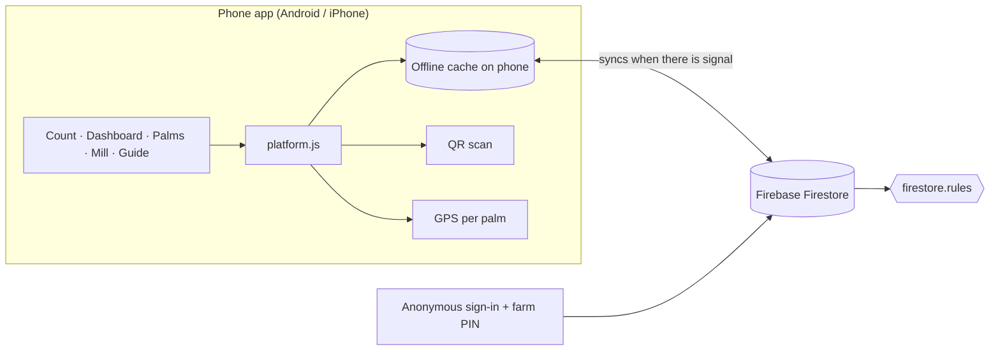
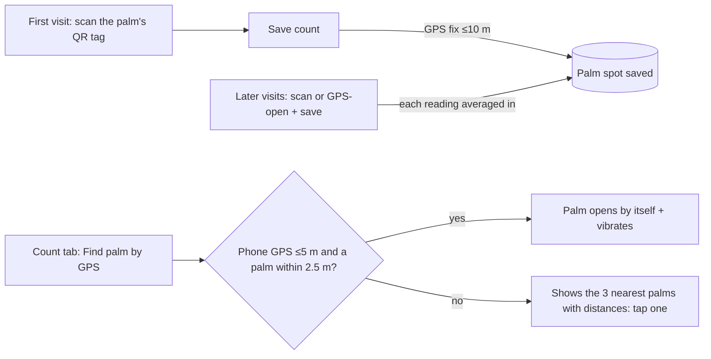

# Palm Bunch Register — mobile app setup

Android + iPhone app built with Capacitor from the same screens as the claude.ai version.
Data lives in your own Firebase project and works offline in the field.



## 1. Create the Firebase project (once, about 10 minutes)

1. Go to https://console.firebase.google.com → **Add project** → name it e.g. `palm-bunch-register` (Analytics not needed).
2. **Build → Authentication → Get started → Sign-in method → Anonymous → Enable.**
3. **Build → Firestore Database → Create database** → choose region `asia-south1 (Mumbai)` → start in **production mode**.
4. **Firestore → Rules** → paste the contents of `firestore.rules` → **Publish**.
5. **Firestore → Data → Start collection** `secret` → document ID `join` → two string fields:
   - `workerPin` — the PIN you give to taggers (e.g. `4729`)
   - `adminPin` — your own owner PIN (keep it private)
6. **Project settings (gear) → Your apps → Web (`</>`)** → register app → copy the `firebaseConfig` values into `src/firebase-config.js`.

The first person to join with the owner PIN opens **Setup** and enters the farm name and blocks
(B01, 10 acres, 570 palms).

## 2. Build

```bash
npm install
npm run android        # builds android/app/build/outputs/apk/debug/app-debug.apk
```

Copy `app-debug.apk` to each Android phone (WhatsApp/Drive/USB) and install it
(allow "Install unknown apps" once).

### iPhone

Needs full **Xcode** from the Mac App Store and an Apple Developer account ($99/year) to put the app on
other people's iPhones (TestFlight). Then:

```bash
npm run sync
npx cap open ios       # in Xcode: select your team under Signing, then Product → Archive → TestFlight
```

## 3. How joining works

- First launch needs signal: the app signs in anonymously, asks for **name + farm PIN**.
- Worker PIN → can count, save GPS, add mill tickets.
- Owner PIN → also Setup, deleting tickets, removing members.
- After joining, counting works with no signal; entries sync later. A yellow note shows while
  saves are waiting to sync.
- To stop a phone from writing: Firebase console → Firestore → `members` → delete that document.

## 4. Tags

Palms tab → **Make tag PDF** → shares the PDF (print on weatherproof stickers). New QR codes contain
just the palm ID (`B01-0143`); the in-app **Scan tag** button opens that palm.

## 5. GPS: tag once, then the app finds the palm



- **First time:** scan the tag while standing at the palm, count, save. The spot is saved
  automatically (or tap **Save GPS here**). Palms opened by typing the number are not geotagged
  automatically, because the person may not be standing there.
- **Every later visit** adds another reading and the saved spot is averaged (sharper readings count
  more), so it tightens toward about 1.5–2 m over a few months.
- A reading more than about 8 m from the saved spot is rejected (likely a wrong tag). Tapping
  **Save GPS** again within a minute replaces the spot.
- **Find palm by GPS** (Count tab) keeps GPS on. When the phone reports ±5 m or better and one palm
  is within 2.5 m (8 ft), clearly closer than the next, that palm opens by itself. After **Save**
  the sheet closes and you walk to the next palm.
- Under thick canopy phone GPS is often ±5–10 m, so expect the nearest-palms list there instead of
  auto-open. The QR tag stays the sure way.
- Palms tab → **Export GPS (CSV)** for a map or a drone overlay.

## Files

| File | What it is |
|---|---|
| `src/app.js` | The app (same logic as the claude.ai version) |
| `src/platform.js` | Firebase, join screen, QR scan, GPS, file sharing |
| `src/firebase-config.js` | Your Firebase keys |
| `firestore.rules` | Who can read and write what |
| `src/public/img/` | Stage photos (credits in the Guide) |
